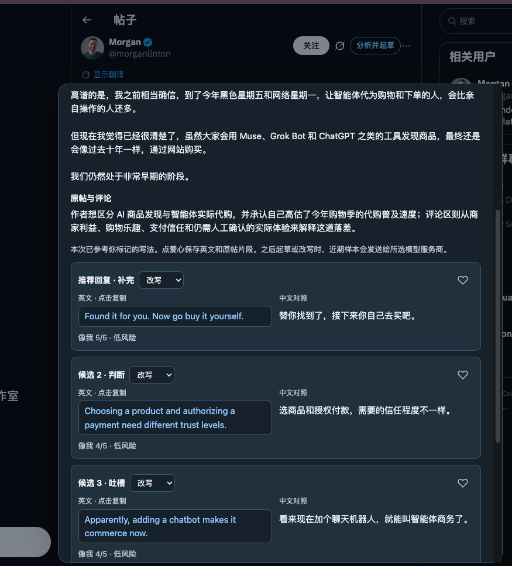
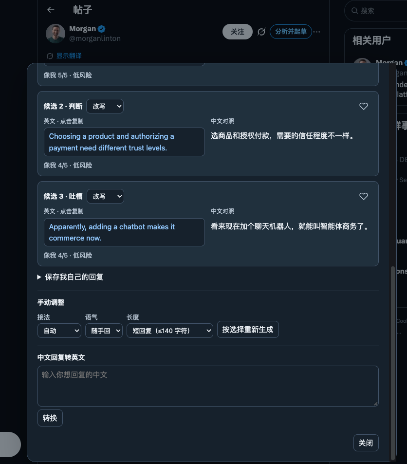

# X 运营助手

**面向 X 英文区创作者的 Chrome 扩展。先在首页找到值得回复的帖子，再把想法变成自然的英文回复。**

当前版本 **v1.6.1** · Chrome 120+ · OpenAI / DeepSeek

作者在 X 分享英文区运营实测、AI 工具用法和插件更新。 [访问 @yuntan4 的 X 主页](https://x.com/yuntan4) · [作者 GitHub](https://github.com/qianchongyang)

## 它能做什么

| 你想做的事 | 扩展提供的功能 |
| --- | --- |
| 刷首页时快速筛帖 | 在 `x.com/home` 对当前最多 10 条已加载帖子按回复机会排序，优先考虑英文帖。滚动后更新。 |
| 看懂一条帖为什么排在前面 | 悬停帖子右上方的分数，查看帖龄、浏览、回复、粉丝、关注关系和各项得分。 |
| 读懂英文原帖和讨论 | 在帖子详情页点「分析并起草」，看原帖中文、作者和评论区在聊什么，以及是否建议回复。 |
| 快速写出自己的英文回复 | 生成三条不同角度的双语建议，点英文复制。可以单条改写，也可以选择接法、语气和长度重新生成。 |
| 翻译自己写的回复 | 在弹窗下方输入中文，点「转换」，再点英文复制。爱心可以保存符合自己写法的示例。 |

扩展只负责筛选、翻译和起草。是否回复、回复什么，由你在 X 里手动决定和发布。

## 实际使用截图

### 1. 刷首页，先找值得看的帖子

在 X 首页，把鼠标移到帖子右上角的数字，就能看到帖龄、浏览量、回复数、粉丝规模和各项得分。图中的 **8 分** 表示这条帖在当前批次里的相对优先级，方便你决定先看哪条。 [查看评分公式](docs/scoring.md)

### 2. 打开帖子，看中文摘要和三种英文回法

点击「分析并起草」后，扩展读取原帖和页面上已加载的回复，展示原帖中文和讨论摘要。图里同一条关于 AI 购物的帖子给出了 **补完、判断、吐槽** 三种接法。每条都有中文对照，点左侧英文即可复制，再回到 X 自己决定是否发布。

查看「分析并起草」入口和生成过程

打开帖子详情页，在原帖右上角点击「分析并起草」。看到「正在起草」时，扩展正在根据这次读到的原帖和回复生成候选。

查看如何改写候选或把自己的中文转成英文

想改一句，点候选卡上的「改写」。想换一批，往下选择接法、语气和长度，再点「按选择重新生成」。已经想好怎么回时，在底部写中文，点「转换」，再点英文译文复制。

## 安装与使用

1. 从 [GitHub Releases](https://github.com/qianchongyang/x-operations-assistant/releases) 下载最新版扩展压缩包并解压。也可以下载仓库源码。
2. Chrome 打开 `chrome://extensions`，开启「开发者模式」，点击「加载已解压的扩展程序」。选择含有 `manifest.json` 的 `x-reply-assistant` 文件夹。
3. 点击工具栏里的「X 运营助手」。选择 OpenAI 或 DeepSeek，填写自己的 API Key 并保存。首次选择 DeepSeek 时，按 Chrome 提示授权连接。
4. 点「刷新模型列表」，选定模型后再次保存。可点「测试已保存的模型」检查连接。连接测试和生成请求会使用你自己的 API 额度。
5. 刷新 X 页面。首页会自动打分，帖子详情页右上角会出现「分析并起草」。只想用首页评分时，可以直接从第 2 步跳到第 5 步。

已安装的用户可以用新版文件替换原扩展目录的内容，然后在 `chrome://extensions` 点击「重新加载」，再刷新 X 页面。设置页中的默认提示词可编辑，内置示例来自作者的写作风格。

## 评分怎么算

首页评分在本机完成。每批最多取 10 条帖子，对 **时效调整后的浏览速度、粉丝规模、累计浏览和回复空位** 分别计算 60、20、10、10 分，再乘以原帖语言系数。按总分排序，本批第一名显示 10 分，依次递减。

10 分表示本批优先查看。浏览速度来自当前浏览数和帖龄的一次估算，评分无法衡量帖子之后的实际曝光。公式、缺失数据处理和示例见 [首页评分算法](docs/scoring.md)。

## 隐私与数据使用

- API Key 和模型配置保存在当前 Chrome 配置的扩展本地存储中。Key 仅用于向对应的模型服务商认证。
- 首页评分只读取当前浏览器已加载的帖子与作者资料卡，在本机计算，使用这一功能无需 API Key。
- 用户发起分析或改写时，选中的服务商会收到主帖、最多 8 条已加载回复、提示词和最近保存的部分风格样本。中文转英文请求只使用你输入的待翻译文字及翻译指令。
- 扩展分析可读的文字。只读到平台译文、帖子有图片或视频、或没有加载评论时，界面会提示相应限制。

## 版本与贡献

**v1.6.1** 为首个 GitHub 公开版本。版本记录见 [CHANGELOG](CHANGELOG.md)。

如果它帮你更快找到值得聊的英文帖子，欢迎给仓库点个 **Star**。遇到问题或有改进思路，欢迎 [提 Issue](https://github.com/qianchongyang/x-operations-assistant/issues) 或提交 PR。尤其欢迎改进 X 页面兼容性、评分解释和英文候选质量。

本地测试用 Node.js 22 运行 `node --test tests/reply-assistant.test.mjs`。提交问题和截图时请移除密钥、Cookie 和个人数据。

这是独立开发的浏览器扩展。
